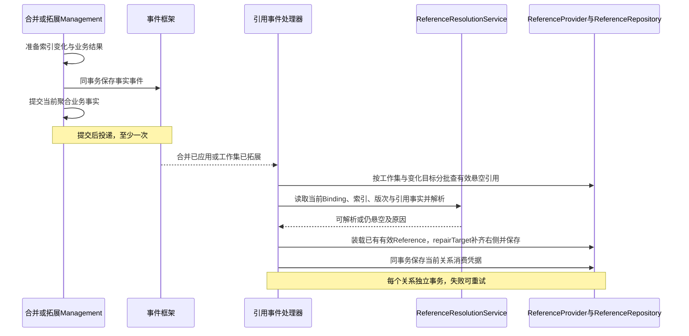

# 事件驱动的悬空引用修复

> 场景：分支合并、工作集拓展。跨聚合提交后消费，最终一致。Diff只读解析，不发事件。

直接使用 Reference，由 ReferenceResolutionService 结合 Binding / LightTrackerItem 解析目标，不增加中间引用模型。

## 1. 事件与提交边界

| 场景 | 事件建议名 | 何时记录事件 |
|---|---|---|
| 分支合并 | BranchMergeApplied | 每个实际成功业务聚合提交后异步交付；索引、Round、Checkpoint、关系分别提交 |
| 工作集拓展 | WorkingSetExtended | 新增 Binding 范围发布时，在单 WorkingSet 事务登记；索引已在独立事务准备完成，隐藏暂存阶段不发 |

随本聚合提交登记事实，由事件框架在成功后可靠交付；框架实现不在本模型展开。复用已有等价事件，不依赖无恢复能力的内存回调。合并不等整轮完成：轮次随后失败或取消，已提交组仍需修复。创建工作集只建立初始关系，不增加第三种修复事件。

**拓展同时恢复因缺端点未建立的合法关联**，需要原关系意图及切点证据；主动删除和明确排除的关联不恢复。其方向与丢弃规则见 [02 §5.1](./02-domain-design.md#51-上游关联与下游关联的取舍)。

## 2. 载荷

| 通用字段 | 场景关联字段 |
|---|---|
| eventId、工作集ID、范围 / 索引版本、实际变化目标的Tracker族根＋CommonId、发生时间、授权上下文关联 | 合并：mergeRoundId、已提交组 / 批次、actionVersion；拓展：extensionId / 发布批次 |

大集合用持久批次清单ID。事件描述已提交事实，不携带覆盖右侧LocalId的写指令；已有Tracker新增Item也必须覆盖。eventId防重复消费，业务批次标识防生产端重试重复发同一事实。

## 3. 消费流程

处理器在应用层逐关系开启事务，装载已有有效Reference，核验后调用repairTarget，经Repository保存。可涵盖entries外旧引用方，但不扩大原合并写集合。

补齐的是**同一引用行**的右侧：ID、逻辑身份、钉版、有效记录不变。左侧或目标内容为VIRTUAL不影响索引定位，不触发内容复制；查询不能因右侧NULL而丢行。

## 4. 最终一致与读取

| 状态 / 读取方 | 约束 |
|---|---|
| 业务结果与修复进度 | 分开报告；修复保存待处理 / 处理中 / 完成 / 失败及游标，失败不回滚成功业务 |
| 仍合法悬空 | 扫描完可记处理完成，不视为技术失败 |
| 清单 / Diff | 可按当前索引只读解析，并注明持久化修复未完成；不写回、不发事件 |
| 传播 / 删除守卫 | 核验消费进度；落后时同步核验或等待，不能把NULL当没有引用 |
| 版本与确认 | 补右侧更新行并发版本，但不改逻辑身份、版次记录、怀疑标记或Checkpoint；实际依赖变化仍按09复核 |

用户不可读只影响脱敏回显，不持久化为全局悬空，也不清空已填右侧。

## 5. 幂等与失败处理

- **逐关系提交**：事件重复投递按 eventId 和目标关系去重；本关系结果与消费凭据一起保存，批次进度异步汇总，不跨关系原子提交。
- **乱序**：事件只定位范围，按当前已提交事实重算；范围版本和条件更新阻止旧结果覆盖新结果。
- **并发**：引用已失效 / 删除则跳过；目标移除、钉版不匹配或授权变化则重算。版本冲突重读重试，不复活关系、不回父对象、不降级HEAD。
- **失败**：保留游标，支持重投及人工重试；合法缺目标不无限重试。修复失败不重放合并。
- **多端点**：只使用已提交索引；循环引用的后续事件可处理补齐端点，未提交组不视为存在。
- **权限与副作用**：使用受控服务身份及工作集范围，用户ID不是无限授权；不补下游引用、拓展可按保留意图建立缺失合法关联、不清怀疑、不markAsMerged。

## 6. 验收

| 场景 | 断言 |
|---|---|
| 成功组后轮次失败 / 取消 | 成功组仍触发，未提交组无事件 |
| 拓展现有Tracker的Item | 事件包含目标身份，能修复旧引用 |
| Outbox业务回滚 | 无事件投递、无提前修复 |
| 重投 / 半批失败 | 游标可接续，无重复关系、无丢批次 |
| 新事件先到 / 旧事件迟到 | 旧结果不覆盖新结果 |
| 消费前引用删除或目标移除 | 不复活、不误绑定 |
| 合并成功但消费失败 | 保留合并成功，独立重试 |
| 进度落后时查询 / Diff / 守卫 | 只读解析正确，守卫不漏判断 |
| 钉版不可用 / 无权 / VIRTUAL | 无降级、泄漏或全量内容复制 |
| 下游关联 | 无悬空行，补索引、重投或修复完成均不恢复 |

本文件为设计与测试计划，未实施运行验证。

拓展的关联恢复不是修改不存在的关系行，而是按保留意图创建 Association。不得只查询现有 Reference 后宣称全部修复完成；完整流程见 [V4 拓展 LRT](../workingsetModel/05-workingset-creation-lrt.md#10-拓展工作集增量纳入与关系恢复)。
